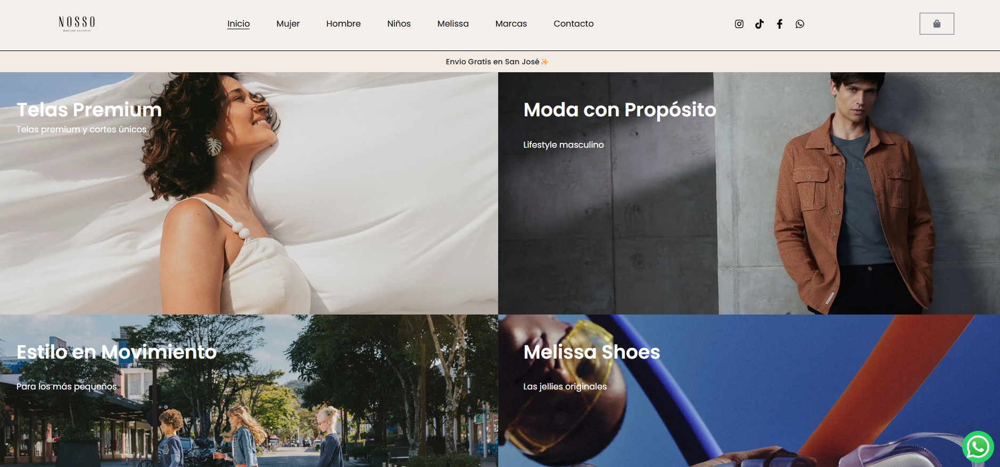

# NossoCR WordPress and WooCommerce

Public portfolio repository for the NossoCR storefront project in Costa Rica.

## Project overview

As Lead Developer, Nícolas Cartín Reyes developed the storefront from scratch using Elementor for page building, WordPress theme selection and customization, and custom PHP, HTML, and CSS. The experience brings product catalogs, promotions, WhatsApp commerce, search visibility, and visual merchandising together for a Costa Rican multi-brand fashion retailer.

## Storefront preview

## Featured case study: NossoCR Melissa Catalog, SEO, and Campaign Update

Three workstreams: prepared WooCommerce bulk-import files for 21 new products and updates to 22 existing products; wrote and validated 21 unique SEO titles and short descriptions; and designed Spanish and English Melissa Reels artwork. The final full catalog and SEO import was not confirmed.

- [Read the complete case study](case-studies/woocommerce-bulk-catalog-upload.md)
- [View the sanitized SEO-copy sample](examples/seo_titles_descriptions_sample_en.csv)
- [View the original vertical campaign artwork](assets/nosso-melissa-reels-en.png)
- [View the optimized WebP artwork](assets/nosso-melissa-reels-en.webp)

The published artifacts are limited to aggregate results, the reviewed SEO-copy sample, and the approved portfolio graphic. No store exports, SKU lists, prices, inventory values, barcodes, orders, customer data, or credentials are included.

## Featured case study: Collection Filtering and Responsive UX

A deployed product-discovery improvement led by **Nícolas Cartín Reyes, Lead Developer**. The shop now offers independent Categories and Brands filters, while the established Color and Size filters on leaf-category and brand archives remain unchanged. Parent categories remain navigation-focused.

- [Read the complete sanitized case study](case-studies/collection-filter-sidebar.md)
- Shop filters use a desktop sidebar above 1024 px and a mobile/tablet bottom sheet at 1024 px or below.
- 19/19 new shop and regression checks passed at 390 px and 1280 px. Separate canonical-page checks also verified a Categories plus Brands combination and reset behavior.
- The automated evidence records an initial HTTP 403 separately from successful DOM assertions; final direct Chrome and iPhone canonical-page checks returned HTTP 200 from the cached current page.
- Production implementation and detailed operational materials remain in the private maintenance repository. This public case study contains narrative only.
- Conversion/CRO outcomes were not measured, and filter terms do not guarantee inventory for every exact product variation.

## Featured case study: Cart, Checkout and Shipping UX

Improvements led by **Nícolas Cartín Reyes, Lead Developer**: mobile product images in the cart, a simpler totals presentation, Costa Rica-specific address fields, required customer contact, shared billing/delivery address choice, conditional shipping controls and an initial Correos delivery selection that respects later customer choices.

- [Read the sanitized cart and checkout case study](case-studies/cart-checkout-workflow.md).
- Manual-assisted and automated checks covered desktop and mobile Chromium, without creating orders or payments.
- Focused validation of the latest initial shipping choice passed, but the broader audit retains address-transfer, shipping-choice and empty-filter findings pending their own regression. The full purchase workflow is not represented as approved.
- Implementation and detailed evidence remain private. No conversion or revenue impact has been measured.

## Case-study index

| Case study | Technical focus | Delivery status |
| --- | --- | --- |
| [Melissa Catalog, SEO, and Campaign Update](case-studies/woocommerce-bulk-catalog-upload.md) | Catalog validation, SEO copy, and bilingual campaign design | Files and artwork prepared; final catalog/SEO import not confirmed |
| [Collection Filtering and Responsive UX](case-studies/collection-filter-sidebar.md) | Contextual Categories, Brands, Color, and Size filtering with responsive UX and release QA | Deployed; 19 new shop and regression checks passed |
| [Cart, Checkout and Shipping UX](case-studies/cart-checkout-workflow.md) | Mobile cart clarity, address/contact handling, shipping conditions and workflow QA | Improvements deployed; full workflow approval remains pending |
| [Platform Maintenance and Smoke QA](case-studies/platform-maintenance-qa.md) | WordPress and WooCommerce maintenance with limited storefront and checkout verification | Updates completed; smoke test passed, full purchase workflow not certified |

## Project focus

- WordPress and WooCommerce storefront management
- Product catalog and merchandising
- Promotions and customer-facing content
- WhatsApp commerce and customer contact paths
- Search engine optimization

## Project lead

Nícolas Cartín Reyes, Lead Developer

## Public portfolio

- Portfolio: https://nikocartin.github.io/
- GitHub profile: https://github.com/NikoCartin

## Curated source

The reviewed export contained a small set of site-specific customizations saved in WordPress. Sanitized excerpts are in [`custom-code/`](custom-code/): one active PHP snippet, two Customizer CSS entries, and two Elementor HTML widgets with the live WhatsApp number replaced by `WHATSAPP_NUMBER`. No custom JavaScript or standalone custom theme/plugin source was identified in the reviewed files.

## Security and data handling

The full hosting archive and database are not included. Production configuration, customer or order data, logs, private media, WordPress core, third-party themes or plugins, and raw catalog exports are excluded. Review and sanitize any future contribution before public release.

Brand logos and trademarks belong to their respective owners and are shown for portfolio purposes only.

## Continuous documentation

[Contribution guidance](AGENTS.md) requires documenting each completed NossoCR contribution in GitHub after explicit user approval. Downloadable backups are produced only on request. Preserve attribution and validation limits, and keep public material sanitized.
